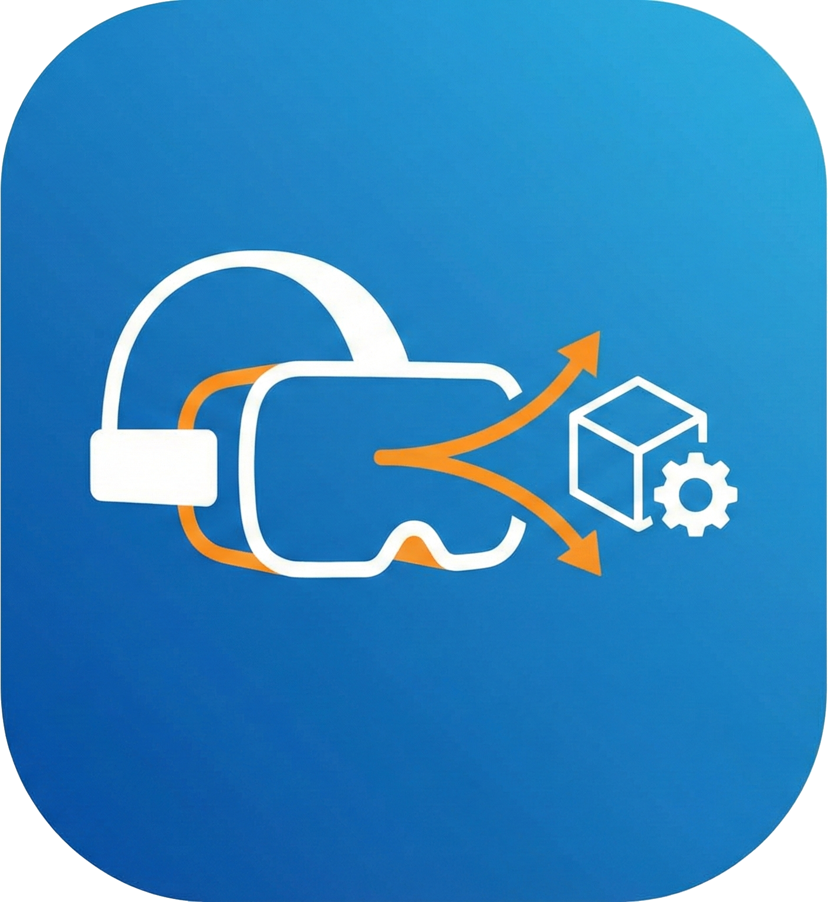

# Fusion 360 to WebXR (AR/VR) Streaming (Standalone Add-in)

<div align="center">
  

  <p>
    <a href="#"></a>
    <a href="#"></a>
  </p>

  <p>
    <b>Export 3D models from Fusion 360 and visualize them instantly in Augmented Reality (Passthrough) on the Meta Quest 3 using WebXR.</b>
  </p>
</div>

---

This project is a **standalone Fusion 360 Add-in** that handles the entire pipeline: it exports the active design as a GLB file (glTF 2.0) and hosts a local HTTPS server directly within Fusion 360. No external Python servers, no internet connection and no complex setups are required during daily use.

The GLB export is written by the add-in itself (no dependencies): every visible body is tessellated, the component tree is kept as glTF nodes, Fusion appearances become PBR materials and the model is exported in meters, so **1:1 scale is exact**. The classic Fusion OBJ export is still available as a fallback.

## 📂 Project Structure

*   **`addin/`**: The complete Fusion 360 Add-in.
    *   `FusionToWebXR.py`: Main logic (Server + UI commands + settings).
    *   `glb_export.py`: Tessellation and GLB writer (pure Python).
    *   `FusionToWebXR.manifest`: Metadata.
    *   `www/`: Web app (`index.html`), local copy of Three.js (`vendor/`) and the exported model (`model.glb` + `scene.json`).
    *   `resources/`: Icons for the UI commands.
*   **`gen_cert.py`**: Helper script to generate self-signed SSL certificates using `trustme` (requires external Python).
*   **`requirements.txt`**: Python dependencies for the certificate generator.

## 🚀 Installation & Usage

### 1. Install Dependencies (One-time Setup)
WebXR requires a Secure Context (HTTPS). Since Fusion's internal Python environment is restricted, you must generate SSL certificates externally **once**.

1.  Ensure you have Python installed on your system.
2.  Install the required library (`trustme`):
    ```bash
    pip install -r requirements.txt
    ```
3.  Run the generator script in the project root:
    ```bash
    python gen_cert.py
    ```
    This will create `cert.pem` and `key.pem` inside the `addin/` folder.

### 2. Install the Add-in in Fusion 360
1.  Copy the `addin/` folder to your Fusion 360 Add-ins directory:
    *   **Windows:** `%AppData%\Autodesk\Autodesk Fusion 360\API\AddIns\`
    *   **Mac:** `~/Library/Application Support/Autodesk/Autodesk Fusion 360/API/AddIns/`
2.  (Optional) You can rename the folder to `FusionToWebXR` for clarity.

### 3. Run the Add-in
1.  Open Fusion 360.
2.  Go to **Utilities** > **Scripts and Add-Ins**.
3.  Select the **Add-Ins** tab.
4.  If you don't see "FusionToWebXR", click the green `+` icon and select the folder you just copied.
5.  Select "FusionToWebXR (Standalone)" and click **Run**.

## 🎮 Workflow

### 1. Start the Server
*   Go to the **Utilities** tab in the main toolbar.
*   Locate the **WebXR Streamer** panel.
*   Click **WebXR Server Starten**.
*   A popup will display the available URLs (e.g., `https://192.168.1.50:8000`).

### 2. Open in Quest 3
*   Put on your Meta Quest 3 headset.
*   Open the **Meta Quest Browser**.
*   Navigate to the URL displayed in Fusion (use the IP address, not localhost).
*   **Security Warning:** Since the certificate is self-signed, the browser will warn you. Click **"Advanced"** -> **"Proceed to ... (unsafe)"**.
*   Once loaded, click **"Start AR"** to enter passthrough mode.

### 3. Export Model
*   Open your design in Fusion 360.
*   Click **WebXR Export** in the panel. Only visible bodies and components are exported (GLB).
*   The model in the headset will update automatically (the web app checks `scene.json` every 2 s and keeps the current position and scale).
*   **WebXR Einstellungen** selects the format (GLB / OBJ) and the tessellation quality.
*   **WebXR Server Stoppen** stops the server.

### 4. Controls (Quest 3)
| Input | Action |
|---|---|
| Trigger (one hand) | Grab, move and rotate the model |
| Both triggers | Scale (the point between your hands stays fixed) |
| B / Y | Reset: scale 1:1 and place the model in front of you |
| A / X | Show / hide the info panel |

## 🛠️ Development

*   **Frontend:** `addin/www/index.html` (Vanilla JS + Three.js 0.160, vendored). No build step required.
*   **Backend:** Python `http.server` (threaded) wrapped in `ssl` (implemented in `FusionToWebXR.py`).
*   **Export:** `addin/glb_export.py` – writes `model.glb` and `scene.json` (metadata: version, bodies, paths, entity tokens, bounding boxes). Files are written to a temp name first and then replaced atomically.
*   **Desktop preview:** serve `addin/www` with any static server (e.g. `python -m http.server --directory addin/www`) – the page shows the model without a headset.
*   **Roadmap:** see [`docs/ROADMAP.md`](docs/ROADMAP.md).
*   **Icons:** `addin/resources/` (PNGs).
